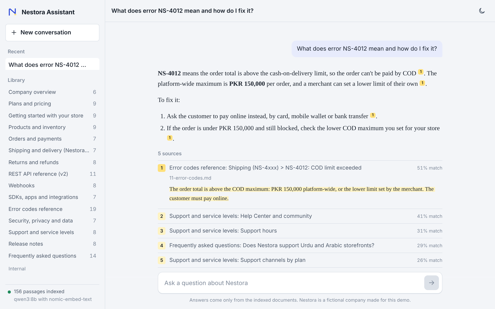
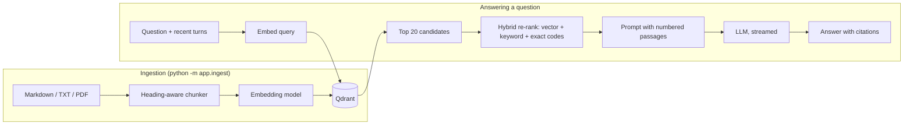

# Nestora Assistant: a RAG chatbot with citations

A retrieval-augmented generation (RAG) assistant that answers questions from a
document collection and shows exactly which passage each claim came from. It runs
**fully locally** with Ollama and Qdrant, and the same code deploys to
**Vercel, Render or any Docker host** with free cloud models. Only environment
variables change.

The bundled knowledge base is the complete documentation of *Nestora Commerce*, a
fictional e-commerce platform: 17 documents (about 85 KB, 156 passages) covering pricing,
payments, shipping, a REST API, webhooks, error codes, policies, an SLA, release
notes, and internal HR and engineering handbooks. Because the company is made up,
a model can only answer correctly by retrieving the passage, so every
correct answer is evidence that the retrieval works.



## Features

- **Web chat** with token-by-token streaming, Markdown answers (lists, tables, code), a stop button, light and dark themes, and conversation history saved in the browser.
- **Clickable citations.** Every `[n]` marker in an answer opens the exact passage it came from, with its document, section and match score.
- **Multi-turn conversations.** Follow-up questions such as "and on the Growth plan?" use the previous question for retrieval and the recent turns for the answer.
- **Retrieval tuned past the basics:** heading-aware chunking with overlap, contextual chunk headers, query/document prefixes for `nomic-embed-text`, and a hybrid re-ranker that boosts exact matches like `NS-4012`.
- **Swappable models.** Use Ollama locally, or any OpenAI-compatible API (Gemini, Groq, OpenAI, OpenRouter, LM Studio, vLLM) by changing `.env`.
- **Three vector-store modes:** Qdrant in Docker, Qdrant Cloud, or embedded on disk with no server at all.
- **Ingests** Markdown, text and PDF files, including sub-folders.
- **Production touches:** health and document-listing endpoints, input limits, per-IP rate limiting, friendly errors when Ollama or Qdrant is down, a Dockerfile, a Compose stack, CI, and a test suite that needs no models.
- **Terminal chat** (`python -m app.cli`) for when a browser is too much.

## How it works



1. **Chunking.** Documents are split by Markdown heading, then paragraphs are packed into chunks of about 900 characters with 150 characters of overlap. Code blocks and tables are never cut in half.
2. **Contextual headers.** Each chunk is embedded together with its document title and heading path (`Plans and pricing > Transaction fees`), so a short passage like "Scale: 0.5%" still carries its meaning.
3. **Retrieval.** The question is embedded and the 20 nearest chunks are fetched. For follow-up questions, a second search combines the previous question with the new one.
4. **Re-ranking.** Dense vectors are weak at exact identifiers, so a keyword-overlap bonus and an exact-match boost for codes such as `NS-4012` are added before the top 5 are kept. Weak matches below `MIN_SCORE` are dropped.
5. **Generation.** The passages are numbered in the system prompt, and the model is told to answer only from them, cite them as `[n]`, and say so when the documents don't cover the question. `<think>` blocks from reasoning models are stripped from the stream.

## Tech stack

| Layer | Local | Cloud |
|---|---|---|
| API and web server | FastAPI, Uvicorn | Same |
| Vector database | Qdrant (Docker or embedded) | Qdrant Cloud (free 1 GB cluster) |
| Embeddings | `nomic-embed-text` via Ollama | `gemini-embedding-001` or any OpenAI-compatible model |
| Chat model | `qwen3:8b` via Ollama | Gemini Flash, Groq, OpenAI and others |
| Front end | Plain HTML, CSS and JavaScript (no build step) | Same |

## Run it locally

You need **Python 3.10+** (3.9 also works), **[Ollama](https://ollama.com/download)** and **Docker** (for Qdrant; see below to skip Docker).

```bash
# 1. Get the code and install dependencies
git clone https://github.com/<your-username>/<your-repo>.git
cd <your-repo>
python3 -m venv venv
source venv/bin/activate            # Windows: venv\Scripts\activate
pip install -r requirements.txt

# 2. Download the models (about 5.5 GB in total)
ollama pull qwen3:8b
ollama pull nomic-embed-text

# 3. Start Qdrant
docker compose up -d qdrant

# 4. Index the knowledge base (about 20 seconds)
python -m app.ingest

# 5. Start the app
uvicorn app.main:app --reload
```

Open **http://localhost:8000** and ask a question. The interactive API docs are at **http://localhost:8000/docs**.

`.env` is optional for this setup, because the defaults match it. To change anything, copy `.env.example` to `.env` and edit it.

### Without Docker

Qdrant can run inside the Python process and store its data in a folder:

```bash
cp .env.example .env
# in .env set:  QDRANT_URL=   and   QDRANT_PATH=./.qdrant
python -m app.ingest
uvicorn app.main:app --reload
```

Embedded mode allows one process at a time, so stop the web server before re-running ingestion.

### On a smaller machine

`qwen3:8b` needs about 6 GB of free memory. On an 8 GB laptop, use a smaller model and set `LLM_MODEL` to match:

```bash
ollama pull qwen3:4b        # or llama3.2:3b
```

### With cloud models instead of Ollama

Set one of the cloud blocks in `.env` (Gemini needs a single free API key from Google AI Studio), then re-run `python -m app.ingest`. Re-indexing is required whenever the embedding model changes, because vectors from different models aren't comparable.

### Everything in Docker

```bash
docker compose up -d --build                    # Qdrant + app, using Ollama on your machine
docker compose run --rm app python -m app.ingest
```

Add `--profile ollama` to run Ollama in a container too (much slower on a Mac, where Docker cannot use the GPU).

## Other ways to use it

**Terminal chat**

```bash
python -m app.cli
```

Type `/reset` to start over or `/quit` to exit. Sources and timing are printed under each answer.

**HTTP API**

```bash
# Whole answer as JSON
curl -s localhost:8000/api/chat -H 'Content-Type: application/json' \
  -d '{"question": "What does error NS-4012 mean?"}'

# Streaming (Server-Sent Events): a sources event, then tokens, then done
curl -N localhost:8000/api/chat/stream -H 'Content-Type: application/json' \
  -d '{"question": "And how do I fix it?", "history": [
        {"role": "user", "content": "What does error NS-4012 mean?"},
        {"role": "assistant", "content": "It means the COD limit was exceeded [1]."}]}'
```

| Method | Path | Purpose |
|---|---|---|
| `GET` | `/` | Chat page |
| `POST` | `/api/chat` | Answer as JSON: `answer`, `sources`, `timing`, `model` |
| `POST` | `/api/chat/stream` | Answer as Server-Sent Events |
| `GET` | `/api/health` | Configuration, number of indexed passages, readiness |
| `GET` | `/api/documents` | Indexed documents with passage counts |
| `POST` | `/chat` | The original v1 endpoint, kept for compatibility |

## Questions worth trying

- How much is the Growth plan, and what do I get over Starter?
- What does error NS-4012 mean and how do I fix it?
- How do I verify a webhook signature in Laravel? (then: *and in Node?*)
- When will I get my first NestPay payout as a new merchant?
- What uptime credit do I get if Scale uptime drops to 98.5%?
- Can I get a refund on an annual plan after six weeks?
- How many days of paternity leave do employees get?
- What are the deployment rules for production? (from the engineering handbook)
- What is the capital of France? (the assistant should say the documents don't cover it)

## Use your own documents

1. Delete the files in `knowledge_base/` (keep the folder) and add your own `.md`, `.txt` or `.pdf` files. Sub-folders are fine.
2. Set `APP_NAME` and `KB_NAME` in `.env`, and change the starter questions at the top of `app/static/app.js`.
3. Run `python -m app.ingest`, or `python -m app.ingest --dry-run` first to preview the chunks without calling any model.

Markdown with clear `##` headings works best, because each chunk remembers the heading it came from.

## Configuration

All settings are environment variables; `.env.example` documents each one. The most important:

| Variable | Default | Meaning |
|---|---|---|
| `LLM_PROVIDER` / `EMBED_PROVIDER` | `ollama` | `ollama` or `openai` (any OpenAI-compatible API) |
| `LLM_MODEL` / `EMBED_MODEL` | `qwen3:8b` / `nomic-embed-text` | Model names |
| `LLM_BASE_URL`, `LLM_API_KEY` | none | Endpoint and key for `openai` providers |
| `EMBED_BASE_URL`, `EMBED_API_KEY` | same as `LLM_*` | Set these to use a different provider for embeddings |
| `QDRANT_URL`, `QDRANT_API_KEY` | `http://localhost:6333` | Qdrant server or Qdrant Cloud |
| `QDRANT_PATH` | none | Embedded mode folder (used when `QDRANT_URL` is empty) |
| `TOP_K` / `CANDIDATES` | `5` / `20` | Passages sent to the model / fetched before re-ranking |
| `MIN_SCORE` | `0.35` | Similarity cut-off; lower it if good questions find no sources |
| `RATE_LIMIT_PER_MINUTE` | `30` | Questions per IP per minute (0 turns it off) |

## Tests

```bash
pip install -r requirements-dev.txt
python -m pytest -q
```

The 19 tests use an in-memory Qdrant and fake embedding and chat models, so they run in under a second with no Ollama, Docker or API keys. They cover chunking, retrieval quality on the real knowledge base, re-ranking, follow-up questions, `<think>` stripping, and every API endpoint. GitHub Actions runs them on Python 3.9 and 3.12 for every push.

## Project structure

```
app/
  main.py              FastAPI app: chat API, streaming, health, static files
  config.py            Settings from environment variables
  services.py          Shared pipeline and vector store instances
  ingest.py            `python -m app.ingest`: load, chunk, embed, store
  cli.py               `python -m app.cli`: terminal chat
  providers/
    embeddings.py      Ollama and OpenAI-compatible embedding clients
    llm.py             Streaming chat clients and the <think> filter
  rag/
    chunking.py        Loaders (md/txt/pdf) and heading-aware chunker
    pipeline.py        Retrieval, re-ranking, prompt building, streaming
  db/
    vector_store.py    Qdrant wrapper (server, cloud or embedded)
  static/              Chat page: index.html, styles.css, app.js, markdown.js
knowledge_base/        The documents that get indexed
tests/                 Pytest suite with fake models
docs/DEPLOYMENT.md     Deploying to Vercel, Render, Railway or a VPS
Dockerfile, docker-compose.yml, render.yaml, pyproject.toml (Vercel entrypoint)
```

## Deployment

Ollama can't run on serverless platforms such as Vercel, so a public deployment uses cloud models (Gemini's free tier works), with Qdrant Cloud's free cluster as the vector database. **[docs/DEPLOYMENT.md](docs/DEPLOYMENT.md)** walks through Vercel, Render, Railway, and a self-hosted VPS that keeps everything on your own server.

## Troubleshooting

| Symptom | Fix |
|---|---|
| "Cannot reach Ollama at http://localhost:11434" | Start Ollama (`ollama serve`, or open the Ollama app). |
| "model 'qwen3:8b' not found" | `ollama pull qwen3:8b` (and `ollama pull nomic-embed-text`). |
| "Collection 'knowledge_base' not found" | Run `python -m app.ingest`. |
| "...holds 768-dim vectors but the embedding model returned 3072 dims" | You changed `EMBED_MODEL`. Re-run `python -m app.ingest`. |
| Ingestion says it cannot reach Qdrant | `docker compose up -d qdrant`, or switch to embedded mode with `QDRANT_PATH`. |
| "Storage folder ... is already accessed by another instance" | Embedded mode is single-process. Stop the server, ingest, start it again. |
| Answers say the documents don't cover a question that they do cover | Lower `MIN_SCORE` (try 0.25) or raise `TOP_K`. |
| Answers are slow | Use a smaller model (`qwen3:4b`), keep `OLLAMA_THINK=false`, or switch to a cloud model. |

## Changes from v1

The first version was a single `/chat` endpoint over a 4 KB text file with one fact per line. Version 2 adds the web chat, streaming, citations, conversation memory, the provider abstraction, heading-aware chunking with contextual headers, hybrid re-ranking, PDF support, configuration through `.env`, deployment files, tests and CI. The old `/chat` endpoint still works.
